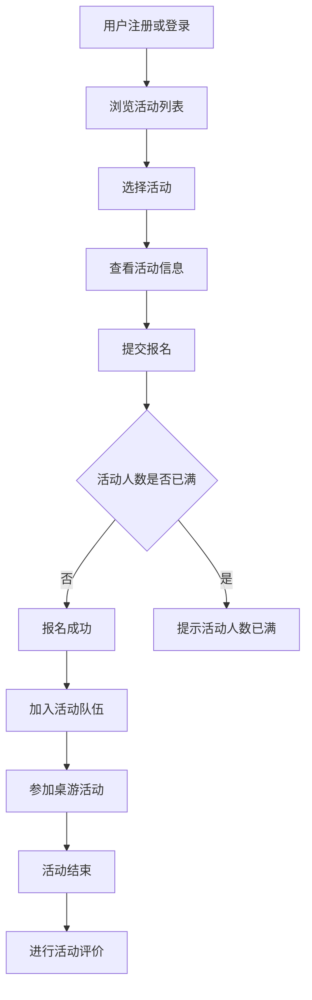

# microservices-practice-2412190325

# 微服务课程实践仓库

## 基本信息

- 课程：微服务架构与实践
- 姓名：施晨煜
- 学号：2412190325

## 仓库用途

本仓库用于完成微服务课程的实践作业。

后续将在同一个仓库中逐步完成需求分析、项目实现、测试、部署以及文档整理等内容。

## 目录说明

- `docs/`：课程作业文档及相关截图
- `src/`：项目源代码
- `docs/homework/week-01/`：第一周实践作业
- `docs/homework/week-02/`：第二周项目选题与功能规划

---

# 桌游社活动管理与组队平台

## 项目简介

桌游社活动管理与组队平台是一个面向高校桌游社团的管理系统，主要用于解决桌游信息管理分散、活动组织效率较低以及新成员融入困难等问题。

目前桌游社主要通过 Excel 表格记录桌游信息，并通过微信群发布活动和组织报名。随着桌游数量和成员数量增加，这种方式逐渐出现信息查询不方便、活动消息容易被聊天记录覆盖、报名人数统计困难等问题。同时，新成员也缺少快速了解社团活动和其他成员的渠道。

本项目计划通过一个统一的平台，对桌游信息、活动、报名、组队和评价等内容进行管理，提高社团活动组织效率，并作为本学期微服务课程持续演进的实践项目。

## 业务背景

目前桌游社日常管理主要存在以下问题：

- 桌游名称、类型、适合人数、拥有者和当前状态等信息主要保存在 Excel 表格中，查询和维护不方便；
- 活动通知主要通过微信群发送，消息容易被其他聊天内容覆盖；
- 活动报名通常需要组织者人工统计，人数变化不够直观；
- 新成员不了解社团有哪些桌游和活动，也缺少了解其他成员的渠道；
- 活动结束后缺少统一的参与记录和评价记录。

因此，本项目设计桌游社活动管理与组队平台，对桌游资源和活动流程进行统一管理。

## 目标用户

| 用户角色 | 主要需求 |
| --- | --- |
| 普通社团成员 | 查看桌游信息、浏览活动、报名参加活动、加入队伍、查看活动记录、进行活动评价 |
| 活动组织者 | 创建活动、设置活动时间和人数限制、管理报名成员、维护活动状态 |
| 社团管理员 | 管理用户、维护桌游信息、管理活动和查看系统基本数据 |

## 选择该题目的原因

选择桌游社活动管理与组队平台作为本学期课程项目，主要有以下原因：

1. 项目来源于实际校园社团场景，业务背景和实际问题比较明确；
2. 系统包含普通成员、活动组织者和管理员等多个用户角色；
3. 项目包括用户、桌游、活动、报名、组队和评价等多个功能模块，能够满足后续课程实践要求；
4. 后续可以逐步加入数据库持久化、认证授权、服务拆分、消息通信、事务管理、系统监控和部署等功能；
5. 项目规模适中，适合作为本学期持续演进的课程项目。

## 项目目标和适用场景

### 项目目标

本项目主要目标是：

- 对桌游信息进行统一管理；
- 提供清晰的活动发布和浏览入口；
- 简化活动报名和人数统计过程；
- 提供组队功能，方便成员参与活动；
- 记录成员活动参与情况和评价；
- 为后续微服务架构实践提供完整业务场景。

### 适用场景

本项目主要适用于：

- 高校桌游社团日常管理；
- 校园兴趣社团活动管理；
- 小规模线下活动的发布、报名和组队。

## 用户角色及需求

### 普通社团成员

普通成员可以：

- 注册和登录系统；
- 查看桌游信息；
- 查看当前可以参加的活动；
- 报名参加活动；
- 加入活动队伍；
- 查看个人参与过的活动；
- 活动结束后进行评价。

### 活动组织者

活动组织者可以：

- 创建桌游活动；
- 设置活动名称、时间、地点和人数限制；
- 查看报名成员；
- 修改活动信息；
- 管理活动状态。

### 社团管理员

管理员可以：

- 管理用户信息；
- 添加、修改和删除桌游信息；
- 管理桌游状态；
- 管理异常活动；
- 查看平台基本数据。

## 功能模块

### 用户模块

主要功能：

- 用户注册；
- 用户登录；
- 用户信息维护；
- 用户角色管理；
- 查看个人活动记录。

### 桌游管理模块

主要功能：

- 添加桌游；
- 修改桌游信息；
- 删除桌游；
- 查看桌游列表；
- 按类型查询桌游；
- 查看桌游适合人数；
- 查看桌游当前状态。

### 活动管理模块

主要功能：

- 创建活动；
- 设置活动时间；
- 设置活动地点；
- 设置活动人数限制；
- 查看活动列表；
- 报名参加活动；
- 取消报名；
- 修改活动状态。

### 组队模块

主要功能：

- 创建活动队伍；
- 加入活动队伍；
- 查看队伍成员；
- 管理队伍人数。

### 评价模块

主要功能：

- 活动结束后进行评价；
- 查看历史活动评价；
- 记录成员活动参与情况。

## 核心业务流程



## Week 03 工程起步

工程位于 `monolith/`，Java 25、Spring Boot 4.0.8。第 03 周完成 GET `/api/hello`、健康检查与启动测试。运行方式现以 Week 04 配置为准。

## Week 04：活动发布与报名

所有新增代码沿用 `com.zjgsu.scy.monolith`，继续开发原有 `monolith/`。实现 Activity、Registration、Service、Controller、JPA Repository、输入输出 DTO 和自动测试。

### 本地环境与测试

需要 JDK 25（沿用第 03 周）和 Maven Wrapper。macOS 可使用 `brew install openjdk@25`，并按 Homebrew 提示配置 JAVA_HOME。先确认 `java -version`。

```bash
cd monolith
chmod +x mvnw
./mvnw test
```

测试使用 H2，自动建表、准备数据及回滚清理，不需要启动 MySQL。

### macOS 安装 MySQL 与建表

```bash
brew install mysql@8.4
brew services start mysql@8.4
export PATH="$(brew --prefix mysql@8.4)/bin:$PATH"
# 在仓库根目录执行；若设置了 root 密码，加 -p
mysql -u root < monolith/scripts/init.sql
mysql -u root
```

在 MySQL 控制台执行：

```sql
CREATE USER IF NOT EXISTS 'boardgame'@'localhost' IDENTIFIED BY 'boardgame_dev';
GRANT SELECT, INSERT, UPDATE, DELETE ON boardgame_club.* TO 'boardgame'@'localhost';
```

`boardgame_dev` 是本地开发示例密码；实际配置可通过环境变量覆盖：

```bash
cd monolith
export DB_USERNAME=boardgame
export DB_PASSWORD=boardgame_dev
export DB_URL='jdbc:mysql://localhost:3306/boardgame_club?useSSL=false&allowPublicKeyRetrieval=true&serverTimezone=Asia/Shanghai&characterEncoding=UTF-8'
./mvnw spring-boot:run
```

默认端口 8080；默认 MySQL 配置位于 `src/main/resources/application.yml`。已有同名库若表结构不一致，应人工迁移或使用新开发库；init.sql 不会覆盖已有数据。

### 可直接运行的 curl 示例

下面创建活动使用未来日期。若执行时间已晚于该日期，请换成未来时间。报名时使用创建响应中的实际 id。

```bash
curl -i -X POST http://localhost:8080/api/activities \
  -H 'Content-Type: application/json' \
  -d '{"name":"桌游之夜","location":"学生活动中心","startsAt":"2099-10-17T19:00:00","capacity":2}'

curl -i http://localhost:8080/api/activities

curl -i -X POST http://localhost:8080/api/activities/1/registrations \
  -H 'Content-Type: application/json' \
  -d '{"memberNo":"2412190325","memberName":"施晨煜"}'
```

自动完成创建、查询、报名、重复及人数上限验证，避免写死活动 ID：

```bash
# 在 monolith/ 中，需要 Python 3
python3 scripts/smoke-test.py
```

| HTTP | 路径 | 用途 / 状态码 |
| --- | --- | --- |
| POST | /api/activities | 创建，201 + Location |
| GET | /api/activities | 列表，200 |
| GET | /api/activities/{id} | 详情，200 / 404 |
| POST | /api/activities/{id}/registrations | 报名，201 / 404 / 409 |
| GET | /api/activities/{id}/registrations | 报名列表，200 / 404 |
| GET | /api/activities/{id}/registrations/{registrationId} | 报名详情，200 / 404 |
| GET | /api/courses | 课内课程示例，200 |

无效请求返回 400；重复报名、人数已满、活动已开始返回 409。Controller 不直接访问 Repository。使用学号检查重复；暂无身份认证，仅用于课程业务验证。

数据库设计见 [docs/database.md](docs/database.md)，本周记录及证据见 [docs/homework/week-04/index.md](docs/homework/week-04/index.md)。


## Week 05：Docker 容器化（课后）

需要 Docker Desktop（已启动）、Docker Compose v2、Python 3。Java 与 Maven 均在构建容器中运行，本机无需 JDK 25。

```bash
# 在仓库根目录。可以手动 cp .env.example .env 并修改密码，
# 或使用下面脚本生成随机密码。已有 .env 不覆盖。
bash scripts/week05/setup-env.sh
docker compose config --quiet
docker build -t scy-boardgame:week05 ./monolith
docker compose up -d --build
docker compose ps
docker compose logs --tail=50 app
```

数据库为 MySQL 8.4.11，应用使用 mysql 服务名连接；命名卷保存数据；数据库健康后启动 app。
.env 不提交。不要把 docker compose config 的完整输出截图或提交，以免暴露密码，检查配置使用 --quiet。

```bash
curl -i http://localhost:8080/actuator/health
curl -i -X POST http://localhost:8080/api/activities \
  -H 'Content-Type: application/json' \
  -d '{"name":"Week05桌游之夜","location":"学生活动中心","startsAt":"2099-10-25T19:00:00","capacity":6}'
curl -i http://localhost:8080/api/activities
```

完整记录真实运行结果，并自动检查同一活动与报名在容器重建后是否一致：

```bash
python3 scripts/week05/verify.py build
python3 scripts/week05/verify.py up
python3 scripts/week05/verify.py api
python3 scripts/week05/verify.py persist
```

截图由本人在终端实际运行后截取，保存于 docs/homework/week-05/screenshots/。验证不自动截图。

```bash
# 停止服务，保留数据卷
docker compose down
# 再次启动，不重新构建
docker compose up -d
```

不要执行 down -v，它会删除数据库数据。如果 8080 被占用，在 .env 中修改 APP_PORT，验证脚本自动读取新端口。
详细过程见 [Week 05](docs/homework/week-05/index.md)。课内校园选课工程在独立交付目录运行，端口默认 8081，截图单独提交。
